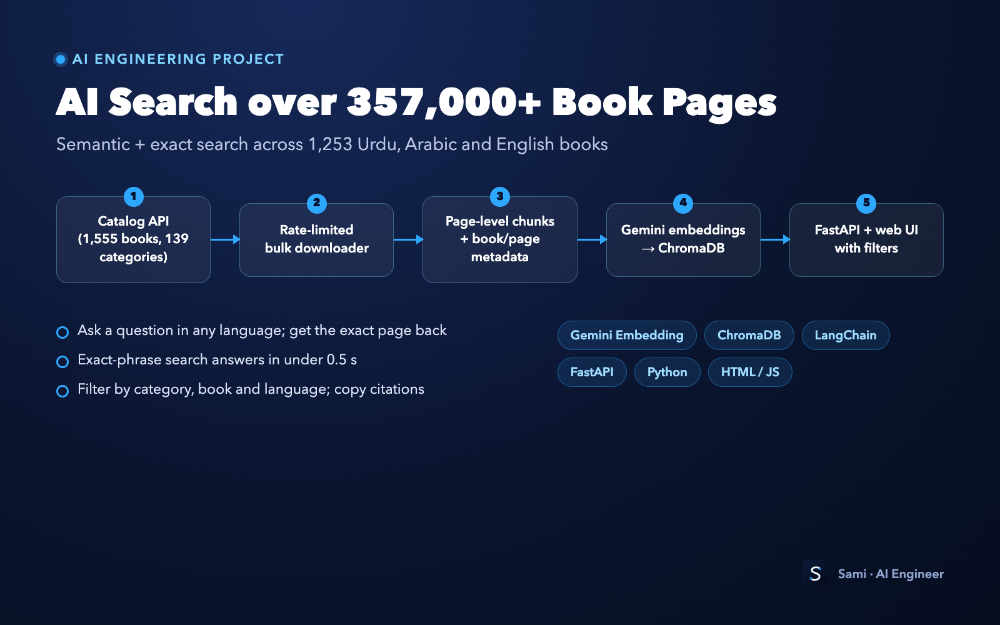
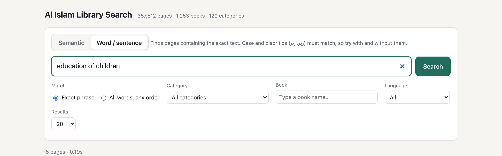
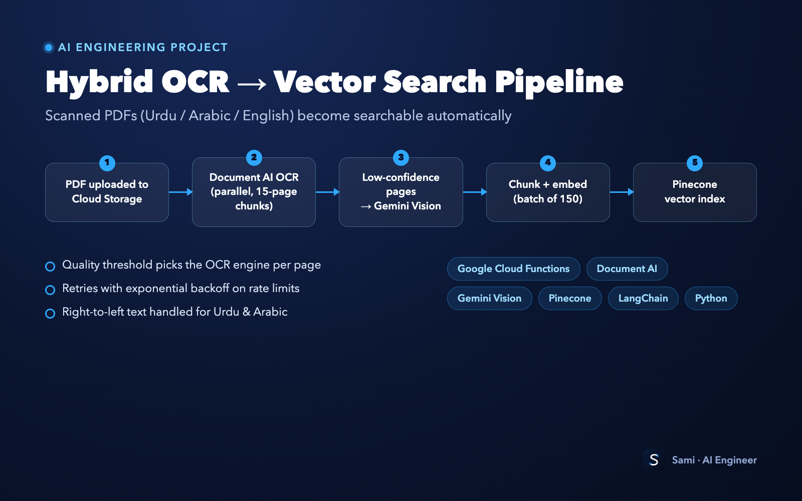
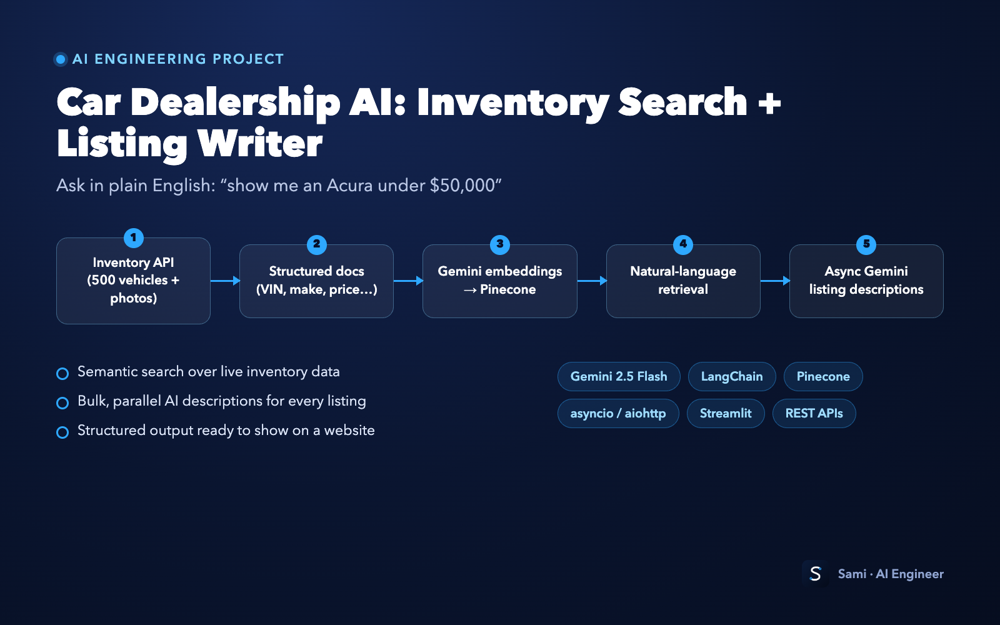
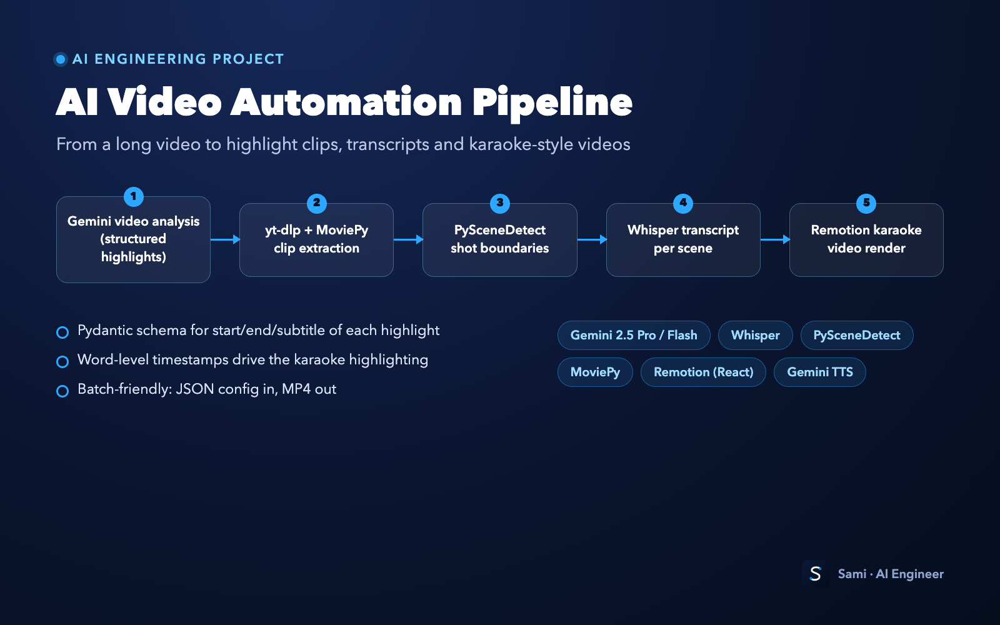
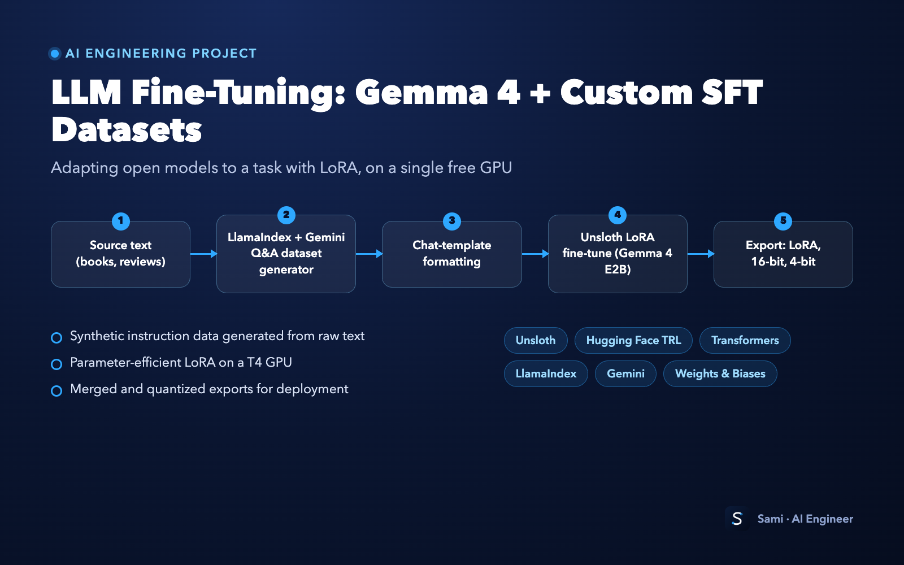
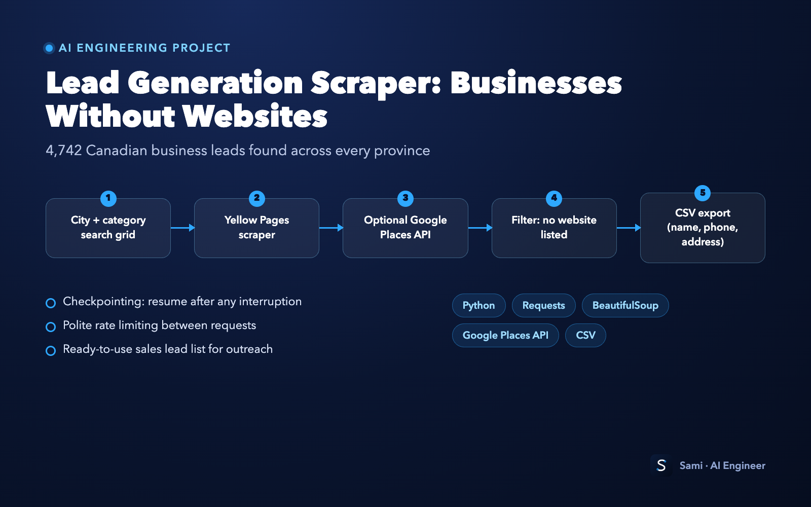

# AI Engineering Portfolio: Sami

Code samples from AI systems I've built: RAG search, document AI pipelines, LLM integrations, video automation, fine-tuning and data scraping.

I'm an AI engineer (since 2023) who builds AI agents, RAG chatbots, n8n/Python automations and MCP integrations.
Hire me on Freelancer: **https://www.freelancer.com/u/samiull5566**

---

| # | Project | What it shows | Stack |
|---|---------|---------------|-------|
| 1 | [Multilingual Library RAG](01-multilingual-library-rag/) | Semantic + exact search over **357,512 pages** from 1,253 Urdu/English/Arabic books, with a FastAPI web UI | Gemini Embedding, ChromaDB, FastAPI |
| 2 | [Hybrid OCR → Vector Search](02-hybrid-ocr-pipeline/) | Serverless pipeline: Document AI OCR, with Gemini Vision as a fallback for hard pages, then Pinecone | GCP Cloud Functions, Document AI, Gemini, Pinecone |
| 3 | [Car Dealership AI](03-car-dealership-ai/) | Plain-English inventory search over 500 vehicles + bulk AI listing descriptions | LangChain, Pinecone, Gemini, asyncio |
| 4 | [AI Video Pipeline](04-ai-video-pipeline/) | Gemini highlight detection → auto clips, scene detection + Whisper, karaoke video rendering | Gemini, Whisper, PySceneDetect, MoviePy, Remotion |
| 5 | [LLM Fine-Tuning](05-llm-fine-tuning/) | LoRA fine-tune of Gemma 4 E2B + synthetic SFT dataset generation | Unsloth, TRL, LlamaIndex |
| 6 | [Lead Generation Scraper](06-lead-generation-scraper/) | Finds businesses with no website listed (4,742 leads across Canada), with resume support | Requests, BeautifulSoup, Google Places |

### 1. Multilingual Library RAG
- `book_catalog.py`: builds the catalog (1,555 books, 139 categories) from the library API
- `build_library_rag.ipynb`: rate-limited download, page-level chunks with metadata, Gemini embeddings into ChromaDB
- `search_app.py` + `alislam_search_ui.html`: FastAPI server and UI; semantic search, exact-phrase search, filters by category/book/language

### 2. Hybrid OCR → Vector Search
- `cloud_function/main.py`: runs automatically when a PDF lands in Cloud Storage; parallel Document AI OCR, low-confidence pages re-read by Gemini Vision, chunked, embedded and stored in Pinecone
- `DEPLOYMENT_GUIDE.md`: step-by-step deployment (CLI or Cloud Console)

### 3. Car Dealership AI
- `inventory_rag_search.ipynb`: inventory API, structured documents, Pinecone; natural-language queries like *"show me an Acura under $50,000"*
- `bulk_listing_descriptions.ipynb`: async, parallel Gemini calls that write descriptions for every listing

### 4. AI Video Pipeline
- `gemini_highlight_clips.ipynb`: Gemini returns highlights as a Pydantic schema, then yt-dlp + MoviePy cut and merge the clips
- `scene_detection_whisper.ipynb`: PySceneDetect shot boundaries plus a Whisper transcript for each scene
- `karaoke/`: Remotion (React/TypeScript) renderer that turns audio + word timestamps into a karaoke MP4

### 5. LLM Fine-Tuning
- `gemma4_lora_finetune.ipynb`: Unsloth LoRA fine-tune of Gemma 4 E2B on a free T4 GPU, exported as LoRA / 16-bit / 4-bit
- `synthetic_sft_dataset.ipynb`: generates Q&A training data from raw text with LlamaIndex + Gemini

### 6. Lead Generation Scraper
- `businesses_without_websites.py`: Yellow Pages (plus optional Google Places) search across a city × category grid; filters to businesses with no website; checkpoint/resume; CSV export

---

## Running the code
All API keys are read from environment variables. Copy `.env.example` to `.env` and fill in your own keys. No credentials are included in this repository.

The notebooks are shown with outputs cleared. Datasets, scraped content and vector databases are not included.
